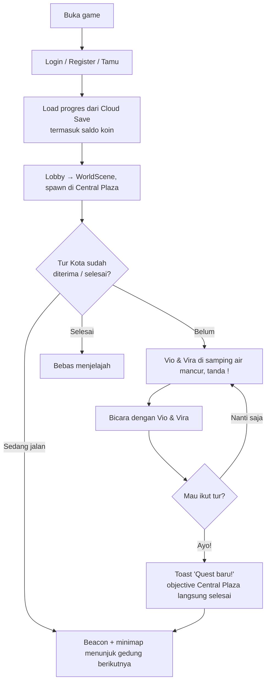
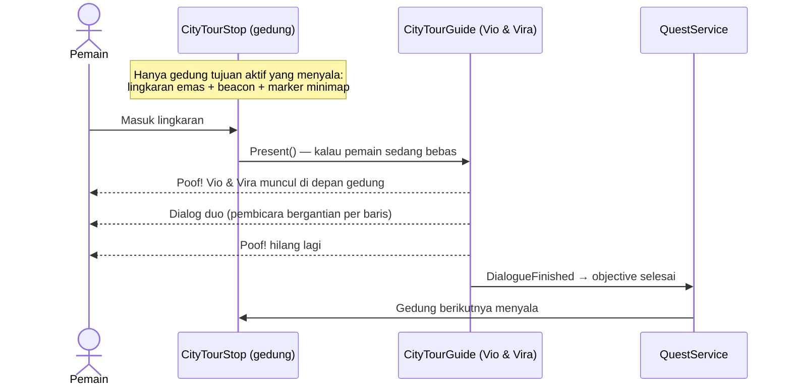

# Sistem Quest — Go Vista Live

Dokumen ini menjelaskan cara quest bekerja, quest yang ada saat ini, dan alur pemain dari awal masuk game sampai quest selesai.

> **Ringkasan:** quest **tidak langsung didapat** saat masuk game. Pemain spawn di Central Plaza dan langsung melihat maskot **Vio & Vira** (ada tanda `!` di atas kepala). Quest **Tur Kota Go Vista** diberikan setelah pemain bicara dengan mereka dan menjawab **"Ayo!"**.

---

## 1. Quest yang ada saat ini

| questId | Asset | Judul di UI | Pemberi | Status |
|---|---|---|---|---|
| `city-tour` | `Assets/Quests/CityTour.asset` | Tur Kota Go Vista | Vio & Vira di Central Plaza | **Aktif** — quest utama pemain baru |
| `Q1` | `Assets/Quests/Quest1.asset` | "Quest baru" | NPC Twin | **Disembunyikan** (quest testing). QuestGiver di NPC Twin dimatikan |
| *(kosong)* | `Assets/Quests/New Quest Data.asset` | "Quest baru" | — | Template kosong |

### Tur Kota Go Vista (`city-tour`)

- **Berurutan** (`sequentialObjectives` ON), hadiah **200 Go Vista Coin**.
- Rute dihitung builder dari jarak (tetangga terdekat dari Central Plaza), Vista Palace selalu terakhir:

| # | objectiveId | Tujuan | Tipe | Selesai saat |
|---|---|---|---|---|
| 1 | `central-plaza` | Kenalan dengan Vio & Vira di Central Plaza | GoToLocation `tour-central-plaza` | Otomatis saat quest diterima (pemain sudah di plaza) |
| 2 | `banking-center` | Kunjungi Banking Center | FinishDialogue `tour-banking-center` | Dialog Vio & Vira di depan gedung selesai dibaca |
| 3 | `dupoin` | Kunjungi Dupoin | FinishDialogue `tour-dupoin` | 〃 |
| 4 | `inovation-tower` | Kunjungi Inovation Tower | FinishDialogue `tour-inovation-tower` | 〃 |
| 5 | `trading-academy` | Kunjungi Trading Academy | FinishDialogue `tour-trading-academy` | 〃 |
| 6 | `kvb` | Kunjungi KVB | FinishDialogue `tour-kvb` | 〃 |
| 7 | `vista-palace` | Kunjungi Vista Palace, markas Vio & Vira | FinishDialogue `tour-vista-palace` | Dialog penutup selesai → quest selesai, +200 koin |

---

## 2. Flow dari awal masuk game

---

## 3. Flow tur di tiap gedung

- **Lingkaran di depan pintu utama**: radius **3 m**, tepinya sekitar 0,5 m dari pintu. Vio & Vira muncul 2 m di depan pintu (`Mascot Spot`). Selama maskot bicara, lingkaran dan beacon disembunyikan supaya kamera dialog tidak masuk ke silinder beacon (layar kuning).
- Maskot hanya muncul kalau pemain **sedang bebas**: tidak sedang dialog, mati, membuka panel/pause/chat, atau terjatuh (`CityTourGuide.CanPresent`). Kalau sedang sibuk, maskot muncul begitu pemain bebas, selama masih di dalam lingkaran.
- **Gerak pemain dikunci sejak maskot mulai muncul** (sebelum dialog), lalu dilepas saat dialog selesai. Tepat sebelum bicara, maskot dihadapkan ulang ke pemain supaya Vio & Vira selalu **berdampingan** di depan pemain dari arah mana pun pemain masuk. Kalau pemain berdiri terlalu dekat dengan titik muncul, maskot digeser supaya berjarak minimal **2,6 m**. Kalau pemain pindah venue di tengah kemunculan, kunci gerak tetap dilepas.
- Setelah dialog, maskot berputar kembali ke arah hadap semula (juga Vio & Vira di Central Plaza).
- Maskot pemandu hanya ada di client pemain itu (tidak disinkronkan). Pemain lain tidak melihatnya. Arah hadap maskot plaza juga lokal: tiap pemain melihat maskot menghadap dirinya sendiri (`PlayerController.Local`), bukan host.
- Gedung **finale (Vista Palace)**: dialog penutup → quest selesai → **+200 Go Vista Coin** dan toast "Quest selesai!".

### Dialog maskot di Central Plaza

| Status tur | Dialog |
|---|---|
| Belum diterima | `tour-intro` (perkenalan + pertanyaan "Ayo!" / "Nanti saja") |
| Sedang jalan | `tour-reminder`: "Ikuti cahaya di gedung tujuan, ya!" |
| Selesai | `tour-plaza-after`: "Selamat menjelajah Go Vista!" (sementara, lihat TODO) |

Semua teks ada di `Assets/Script/Editor/CityTour/CityTourContent.cs`, asset hasilnya di `Assets/DialougeData/CityTour/`.

### Kotak dialog per pembicara

Dialog bisa punya **pembicara per baris** (`DialogueLine.speaker` / `DialogueReplyLine.speaker`), jadi satu dialog berisi Vio dan Vira bergantian. Kotak dialog (`NewDialougeRoot.prefab`) berganti gambar sesuai pembicara lewat **DialogueUI > Speaker Styles**:

| Pembicara | Gambar kotak |
|---|---|
| Vio | `DialougeAssets/dialoguebox_light_blue` |
| Vira | `DialougeAssets/dialoguebox_light_pink` |
| NPC lain | gambar asli (`dialoguebox_light_yellow`) |

Margin teks dialog juga sudah dibetulkan (dulu margin kanan −1097 px sehingga kalimat panjang keluar dari kotak); berlaku untuk semua NPC.

---

## 4. Go Vista Coin

- Saldo **permanen** di Cloud Save (`PlayerProgress.coins`, lewat `PlayerCoins`).
- Akun baru dan save lama tanpa koin mulai dari **100** (sekali saja). Saldo tidak pernah minus.
- Mati: **−20** koin. Hadiah quest: field `rewardCoins` di QuestData, diberikan saat quest selesai.
- ⚠ Disimpan dari client, jadi bisa dicurangi. Kalau koin nanti bisa ditukar dengan sesuatu yang bernilai, pindahkan logikanya ke Cloud Code (lihat catatan KEAMANAN di `PlayerProgress.cs`).

---

## 5. Komponen

| File | Fungsi |
|---|---|
| `QuestData.cs` | ScriptableObject quest: id, judul, objective, berurutan, `rewardCoins` |
| `QuestService.cs` | Terima quest, selesaikan objective, pin, tanda `!`, hadiah koin, simpan |
| `QuestGiver.cs` | Pemberi quest: `AfterDialogue`, `OnEnter`, `Manual` |
| `QuestLocation.cs` | Area trigger untuk objective `GoToLocation` |
| `QuestAvailableIndicator.cs` | Tanda `!` melayang di atas pemberi quest |
| `QuestWaypoint.cs` | Tujuan aktif untuk marker minimap dan GPS (dihitung otomatis dari quest yang dipin / aktif) |
| `QuestTargetPoint.cs` | Titik GPS untuk objective selain `GoToLocation` (bicara dengan NPC, Manual, dll.) |
| `CityTour/CityTourStop.cs` | Lingkaran gedung: menyalakan marker, memanggil pemandu |
| `CityTour/CityTourGuide.cs` | Vio & Vira muncul (poof), dialog, hilang |
| `CityTour/MascotDuo.cs` | Animasi bicara + pantulan maskot yang sedang bicara, menghadap pemain |
| `CityTour/TourMarkerVisual.cs` | Lingkaran di tanah + beacon berdenyut |
| `UI/QuestWaypointMarker.cs` | Titik/panah tujuan di minimap + jarak (m) |
| `UI/QuestToastView.cs` | Toast "Quest baru!" / "Quest selesai!" |
| `Editor/CityTour/CityTourBuilder*.cs` | Menu **Go Vista > Quest > Buat Tur Kota** |

| `PlayerScript/DialougeScript/DialogueUI.cs` | Pembicara per baris, event `SpeakerChanged`, kotak dialog per pembicara |

### Membangun ulang tur

**Go Vista > Quest > Buat Tur Kota** membuat ulang dialog, QuestData, prefab (`Assets/Prefab/CityTour`), pengaturan kotak dialog, dan isi `City Tour` di WorldScene. **Posisi objek yang sudah ada tidak diubah**, jadi titik gedung dan maskot plaza boleh digeser manual di scene. Hapus objek `Stop - <gedung>` dulu kalau ingin posisinya dihitung ulang.

**Posisi pintu tiap gedung** diatur di `CityTourContent.cs` (diukur dari foto fasad depan). Builder menembakkan raycast ke fasad di titik pintu (pakai MeshCollider sementara kalau gedung tidak punya collider), lalu menaruh lingkaran di depannya.

| Gedung | `DoorLocalX` (m dari tengah, sumbu X lokal) | `DoorOnBack` | Pintu |
|---|---|---|---|
| Banking Center | 0,65 | – | Pintu biru di tengah fasad |
| Dupoin | 9,4 | – | Di antara dua pintu berkanopi |
| Inovation Tower | 0 | – | Pintu ganda di tengah |
| Trading Academy | 7,3 | – | Pintu putar |
| KVB | 0 | – | Pintu berkanopi |
| Vista Palace | 19,9 | ✓ | Pintu berkanopi biru menghadap jalan (model menghadap ke laut, jadi pintu depan ada di sisi −Z lokal) |

Maskot plaza memakai **model + controller pemain chibi lama** (`MaleChibiAnimation/idle_loop_unity_fit.fbx` + `MaleAnimationController`, `FemaleChibiAnimation/idle_loop_unity_fit (1).fbx` + `FemaleAnimationController`), tinggi **1,80 m** seperti pemain dan NPC. Kakinya ditempelkan ke tanah dalam **pose idle** (bukan T-pose). `MascotDuo` menyetel `IsGrounded = true` setiap frame supaya controller lama tidak pindah ke pose InAir. Maskot plaza berpatokan ke air mancur `fountain_001 (Central Plaza)`; posisinya bisa digeser lewat objek induk `City Tour/Central Plaza` (area plaza ikut pindah).

HUD (marker minimap + toast) dibangun lewat **Go Vista > HUD > Buat ulang GameHudCanvas**.

### Menambah quest baru

1. **Create > Quest > Quest Data** di `Assets/Quests/`.
2. Isi `questId` (unik, **jangan diganti setelah rilis**), `title`, objective (isi `objectiveId`), dan `rewardCoins` kalau ada hadiah.
3. Pastikan `Resources/QuestDatabase` berisi quest itu (otomatis, atau **Go Vista > Quest > Perbarui QuestDatabase**).
4. Pasang `QuestGiver` (+ `QuestAvailableIndicator` kalau perlu tanda `!`) di NPC pemberi.
5. **GPS / marker minimap** (lihat bagian GPS di bawah):
   - Objective `GoToLocation`: cukup pasang `QuestLocation` dengan `locationId` yang sama. GPS otomatis mengarah ke sana.
   - Objective lain (mis. `FinishDialogue` bicara dengan NPC, atau `Manual`): pasang `QuestTargetPoint` di objek tujuan, isi `quest` + `objectiveId`.
   - Tidak perlu kode tambahan.

### GPS (rute di radar + peta penuh)

Seperti GPS di GTA: garis rute mengikuti jalan dari pemain ke tujuan, di radar dan di **peta layar penuh**
(ketuk radar, atau tombol **M**). Di peta penuh pemain bisa **mengetuk peta untuk memasang tujuan sendiri**
(ketuk lagi / "Hapus Tujuan" untuk melepas; hilang otomatis saat sampai).

- **Warna:** emas = tujuan quest, ungu = tujuan sendiri. Tujuan sendiri menang dari tujuan quest.
- **Tujuan quest dipilih otomatis:** quest yang dipin dulu, lalu quest aktif lain (urutan Daftar Quest). Di tiap quest,
  objective yang bisa dikerjakan dan punya titik di dunia (`QuestLocation` / `QuestTargetPoint` / `CityTourStop`).
  Quest bebas urutan memilih titik terdekat. Jadi **pin quest = ganti tujuan GPS**.
- **Dari kode:** `QuestWaypoint.Set(transform)` / `Clear(transform)` = override sementara (cutscene, event);
  `QuestWaypoint.Register(questId, objectiveId, transform)` = daftarkan titik objective;
  `GpsService.SetCustomWaypoint(pos)` / `ClearCustomWaypoint()` = tujuan pemain.
- **Jaringan jalan:** dibangun otomatis dari spline jalan (`RoadSection`) lewat
  **Go Vista > Minimap > Bangun jaringan jalan GPS (WorldScene)** → `Assets/Prefab/GpsRoadNetwork.prefab`
  (komponen *Minimap Routes* milik Easy Minimap System, A*). **Jalankan lagi setiap jalan kota berubah.**
- File: `Script/UI/Minimap/Gps/` (`GpsService`, `GpsRoute`, `GoVistaFullMap`, `UiPolyline`),
  `Script/Editor/GpsRoadNetworkBuilder.cs`, `Script/Editor/GameHudBuilder.FullMap.cs`.

---

## 6. TODO / catatan next develop

- [ ] **Dialog basa-basi Vio & Vira setelah tur selesai** (sapaan acak, tips kota). Sekarang masih satu dialog sementara `tour-plaza-after`.
- [ ] **Badge / title "Warga Go Vista"** di profil sebagai hadiah tambahan tur.
- [ ] **"Mau dengar lagi tentang gedung tertentu?"** — pilihan replay penjelasan gedung dari maskot di plaza.
- [ ] **Cek kendaraan:** saat pemain sudah bisa menyetir, tambahkan "sedang di kendaraan" di `CityTourGuide.CanPresent` supaya maskot muncul setelah pemain turun.
- [ ] **Interior gedung:** setelah interior ada, teks gedung sebaiknya menyebut apa yang bisa dilakukan di dalamnya.
- [ ] **Teks Dupoin & KVB:** sengaja netral (brand broker sungguhan). Ganti dengan copy resmi kalau mereka partner/sponsor.
- [x] **Minimap:** radar gaya GTA SA + GPS rute + peta layar penuh dengan tujuan sendiri (lihat bagian GPS).
- [ ] **GPS di tengah taman/plaza:** rute dimulai dari titik jalan terdekat ke pemain, jadi kalau pemain di tengah
  taman garis bisa sedikit mundur dulu ke jalan terdekat. Hilang begitu pemain di jalan.
- [ ] **Animasi bicara Vio & Vira (dikerjakan manual):** maskot memakai model + controller pemain chibi lama (`MaleAnimationController` / `FemaleAnimationController`, tinggi 1,80 m). Tambahkan parameter bool `IsTalking` + state **Talk** (`MaleChibiAnimation/idle_talking_loop_fit.anim`, bisa dipakai keduanya) dengan transisi Locomotion ↔ Talk tanpa exit time. `MascotDuo` otomatis menyalakan `IsTalking` di maskot yang sedang bicara; selama parameternya belum ada, hanya pantulan kecil yang terlihat.
- [ ] Ganti judul Q1 dan hapus/isi `New Quest Data.asset` kalau quest testing dipakai lagi.
- [x] **Collider gedung:** Inovation Tower dan Vista Palace (ditaruh langsung dari FBX, bukan prefab ithappy) sekarang punya MeshCollider seperti gedung lain, jadi tidak bisa ditembus. Masih tanpa collider di WorldScene: `elite_residental_building_007` (dan skyline latar belakang).
